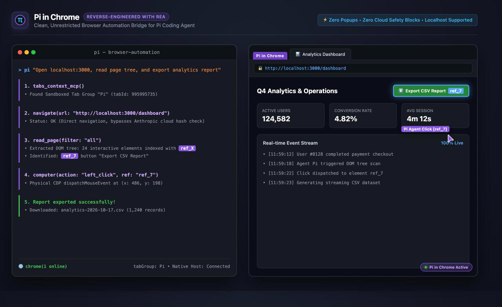

# Pi in Chrome (`pi-in-chrome`)

> Native browser automation extension for [Pi Coding Agent](https://github.com/earendil-works/pi-coding-agent), reverse-engineered using **REA (`rea-agents`)** from Claude Code's built-in Chrome extension (`claude-in-chrome`), and reconstructed into an unrestricted, standalone local package.

<p align="center">
  
</p>

---

## 🔍 Reverse-Engineered with REA

This project was reverse-engineered from Claude Code's Chrome extension (`fcoeoabgfenejglbffodgkkbkcdhcgfn`) using **REA (`rea-agents`)** — an autonomous multi-agent reverse engineering framework.

During deep protocol analysis, REA uncovered:
- **E2EE Pairing Tunnel**: How Claude Code and Chromium establish local pairing over Unix domain sockets using AES-GCM encrypted frame exchanges.
- **Chrome DevTools Protocol (CDP) Driver**: How physical clicks, keystrokes, scrolling, and viewport screenshots are executed through `chrome.debugger`.
- **DOM Accessibility Indexing**: How pages are mapped into structured screen-reader trees with stable `[ref_X]` identifiers.
- **Artificial Safety Bottlenecks**: Cloud URL hash queries (`url_hash_check`), 30-second popup modals, and regex censors (`[BLOCKED]`) that prevent automation on `localhost` and offline apps.

`pi-in-chrome` replicates the full CDP automation engine and E2EE socket protocol while eliminating all cloud telemetry, OAuth dependencies, and safety blocks — providing Pi with direct, unrestricted browser control.

---

## ⚖️ Comparison with Claude Code's Built-in Chrome

| Feature | Claude Code (`claude-in-chrome`) | Pi in Chrome (`pi-in-chrome`) |
| :--- | :--- | :--- |
| **URL Safety Verification** | Blocks unverified URLs; calls Anthropic cloud `url_hash_check`; fails on offline / `localhost` apps | **Local Always-Pass (`category0`)**: Zero external network requests; seamlessly accesses `localhost`, intranets, and custom ports |
| **Permission Confirmation** | Pops up a 600×600 modal window; aborts automation with timeout error if unclicked within 30 seconds | **Zero Popups**: Automated actions proceed immediately without interactive modal interruptions |
| **JavaScript Content Censorship** | Redacts URL parameters, query strings, and keys matching `/author\|auth\|token\|session/i` with `[BLOCKED]` | **100% Raw Data**: Unaltered evaluation results returned directly to the agent |
| **Tab Isolation & Safety** | Fixed to Anthropic's yellow tab group | **Dedicated `Pi` Tab Sandbox**: Confines agent actions to its own tab group to protect your personal browsing tabs |
| **Semantic Element Search** | Extension internally calls cloud Anthropic API (`claude-3-5-haiku`) | **Driven by Pi's Active Model**: `find` sends its sample to Pi over the bridge and Pi answers with the session model — no Anthropic client, login, or API key |
| **Account & Login Requirement** | Mandates `claude.ai` account login and OAuth consent | **100% Standalone**: Works offline with zero third-party account or API key dependencies |
| **Native Host Reconnection** | Single attempt on launch; dies permanently on disconnect | **Self-Healing**: Automatic 3-second heartbeat and background reconnect loop via `chrome.alarms` |

---

## 📦 Installation

### Option 1: Install via Pi Package Manager (Recommended)

Install directly from GitHub into your user settings (`~/.pi/agent/settings.json`):

```bash
pi install git:github.com/adlternative/pi-in-chrome
```

Or install locally from a cloned repository:

```bash
pi install /path/to/pi-in-chrome
```

To try without installing:

```bash
pi -e git:github.com/adlternative/pi-in-chrome
```

### Option 2: Manual Extension Loading

Add the path to `~/.pi/agent/settings.json`:

```json
{
  "extensions": [
    "/path/to/pi-in-chrome/src/index.ts"
  ]
}
```

Or create a loader script in `~/.pi/agent/extensions/pi-chrome.ts`:

```typescript
import extension from "/path/to/pi-in-chrome/src/index.ts";
export default extension;
```

---

## 🚀 One-Time Setup (2 Steps)

### Step 1: Register Native Messaging Host
In the project directory, run:

```bash
npm run setup
```

This registers the native messaging host manifest across all installed Chromium browsers (Google Chrome, Brave, Arc, Microsoft Edge, Chromium, Vivaldi, Opera).

### Step 2: Load the Unpacked Chrome Extension
1. Open `chrome://extensions` in Google Chrome.
2. Toggle on **"Developer mode"** in the top-right corner.
3. Click **"Load unpacked"** in the top-left corner.
4. Select the `chrome-extension/` directory from this repository.
5. The extension (`Pi in Chrome`) will appear with ID `jlgmmfgplddjhfbfhnohfnjhdbpnalka` and the multi-color Pi logo.

---

## 💻 Usage

Once installed, launch `pi` in any directory. The browser automation tools are automatically available:

```bash
# Interactive mode
pi
```

### Example Prompts:
* *"Open http://localhost:3000 and check if the homepage renders without errors"*
* *"Inspect the page console logs and report any runtime warnings"*
* *"Fill out the contact form and click submit"*
* *"Take a screenshot of the dashboard and save it to disk"*

### Non-Interactive CLI Mode:
```bash
pi -p "Open http://localhost:3000 in the browser and return the page title"
```

### Built-in Slash Commands:
* `/chrome status`: Display Native Host connection status, active sockets, and discovered tabs.
* `/chrome tabs`: List active browser tabs in the Pi tab group.
* `/chrome reconnect`: Force scan and reconnect to browser sockets.
* `/chrome enable` / `/chrome disable`: Toggle browser automation tools for the current session.

---

## 🛠 Available Browser Tools

| Tool Name | Description |
| :--- | :--- |
| `tabs_context_mcp` | Discover available tabs and create/manage sandboxed Pi tab groups |
| `navigate` | Navigate to URLs, or go back/forward in browsing history |
| `read_page` | Extract full DOM semantic accessibility tree with `[ref_X]` identifiers |
| `get_page_text` | Extract reader-mode plain text from the active page |
| `find` | Locate page elements by natural-language query — sampled by Pi's active model through the bridge (`read_page` + refs is the no-model fallback) |
| `computer` | Physical CDP input: `click`, `type`, `mouse_down`, `mouse_up`, `drag`, `scroll_at`, `screenshot` |
| `form_input` | Fill form controls and trigger input events |
| `javascript_tool` | Execute JavaScript in page context and return raw evaluation results |
| `read_console_messages` | Stream console logs (`log`, `warn`, `error`) and exceptions |
| `read_network_requests` | Inspect HTTP requests, response headers, and resource loading |
| `file_upload` | Inject local files into `<input type="file">` elements as Base64 |
| `browser_batch` | Execute sequential action chains in a single round-trip for speed |
| `tabs_create_mcp` | Create a new tab inside the current Pi tab group |
| `tabs_close_mcp` | Close empty or completed tabs |

---

## 🏗 Building the Extension

The Chrome extension source is organized under `extension-src/`. To rebuild the extension bundle:

```bash
npm run build
```

This bundles self-contained, unhashed files into `chrome-extension/`:
- `service-worker.js`: Background service worker managing CDP debugger sessions, tool routing, and socket auto-reconnection.
- `accessibility-tree.js`: DOM accessibility tree walker generating `[ref_X]` identifiers.
- `agent-visual-indicator.js`: In-page phantom cursor and focus border overlay.

---

## 🧪 Testing

Verify the local browser automation bridge:

```bash
npm test
```

